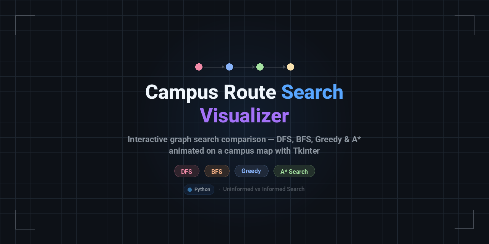
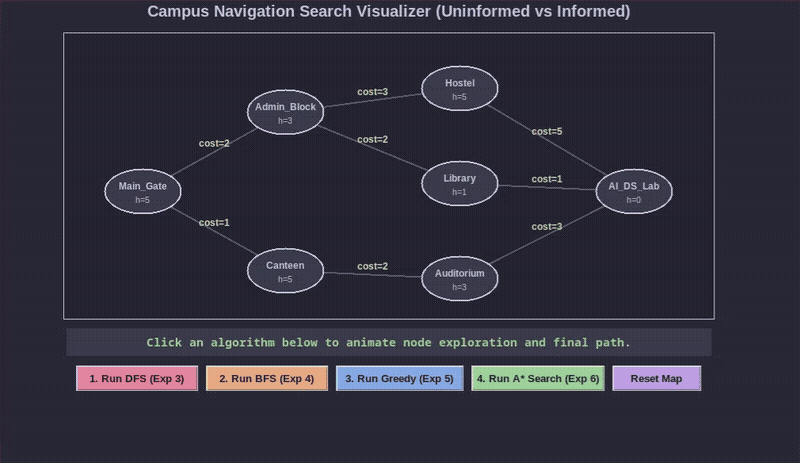

<div align="center">

# 🧭 Campus Route Search Visualizer
### Uninformed vs. Informed AI Search Strategies





[](https://www.python.org/)
[](https://docs.python.org/3/library/tkinter.html)
[](./LICENSE)

*An interactive, real-time GUI simulator designed to visualize, trace, and contrast classical uninformed (blind) and informed (heuristic) search algorithms across a directed, weighted campus map.*

---

</div>

## 📌 Overview

**Campus Route Search Visualizer** brings classical AI graph search strategies to life with animated state transitions. Set within a campus topology—navigating from **Main Gate** to the **AI & DS Lab**—this visualizer demonstrates step-by-step node exploration, frontier expansion, and path reconstruction across both blind and heuristic-driven algorithms.

---

## 🚀 Implemented Algorithms

| Algorithm | Category | Data Structure | Optimality Guarantee | Completeness |
| :--- | :--- | :--- | :--- | :--- |
| **Depth-First Search (DFS)** | Uninformed (Blind) | **Stack** (LIFO) | ❌ Non-optimal (finds *a* path) | ✅ Complete (finite graphs) |
| **Breadth-First Search (BFS)** | Uninformed (Blind) | **Queue** (FIFO) | ⚠️ Fewest hops only | ✅ Complete |
| **Greedy Best-First** | Informed (Heuristic) | **Priority Queue** ($h(n)$) | ❌ Susceptible to local minima | ⚠️ Incomplete in infinite spaces |
| **A\* Search** | Informed (Optimal) | **Priority Queue** ($f = g + h$) | ✅ **Guaranteed Optimal** | ✅ Complete |

---

## 🗺️ Campus Graph & Heuristics

The map is modeled as a weighted directed adjacency graph where:
- **Source Node ($S$):** `Main_Gate`
- **Goal Node ($G$):** `AI_DS_Lab`

```text
               [Admin_Block] (h=3)
              ↗       ↘
      (cost=2)         (cost=2)
            ↗             ↘
 [Main_Gate] (h=5)     [Library] (h=1) ──(cost=1)──> [AI_DS_Lab] (h=0) [GOAL]
            ↘             ↗                          ↗          ↗
      (cost=1)         (cost=3)               (cost=5)   (cost=3)
              ↘       ↗                          ↗          ↗
               [Canteen] (h=5) ──(cost=2)──> [Auditorium] (h=3)
                                          [Hostel] (h=5)
```

### Heuristic Estimates $h(n)$
Admissible heuristic estimates representing the approximate cost to reach `AI_DS_Lab`:
- `Main_Gate`: $5$
- `Admin_Block`: $3$
- `Canteen`: $5$
- `Hostel`: $5$
- `Library`: $1$
- `Auditorium`: $3$
- `AI_DS_Lab`: $0$

---

## 🎨 Visual Color Legend

The interactive canvas uses distinctive color coding throughout the exploration phase:

| Color | Hex | Meaning |
| :--- | :--- | :--- |
| 🟡 **Yellow** | `#f9e2af` | **Active Node** — Currently selected and being expanded |
| 🔵 **Blue** | `#89b4fa` | **Explored / Closed Set** — Already visited nodes |
| 🟢 **Green** | `#a6e3a1` | **Optimal / Final Path** — Reconstructed route & edges |
| ⬛ **Dark Slate** | `#313244` | **Unvisited Node** — Remaining in frontier or untouched |

---

## 💻 Tech Stack & Requirements

- **Language:** Python 3.8+
- **GUI Framework:** Tkinter (Standard Python Library)
- **Dependencies:** None (zero external packages required)

---

## ⚡ Getting Started

### 1. Clone the Repository
```bash
git clone https://github.com/Shubhankar-Kulkarni/Simple-Reflex-vs-Goal-Based-Agent.git
cd Simple-Reflex-vs-Goal-Based-Agent
```

### 2. Run the Visualizer
```bash
python3 Main.py
```

*(If Tkinter is missing on Debian/Ubuntu systems, install it via: `sudo apt-get install python3-tk`)*

---

## 🎮 How to Use

1. **Launch the Application:** Run `Main.py` to bring up the 860×540 dark-themed dashboard.
2. **Select an Algorithm:**
   - Click **Run DFS (Exp 3)** to watch depth-first exploration via stack.
   - Click **Run BFS (Exp 4)** to observe level-by-level queue expansion.
   - Click **Run Greedy (Exp 5)** to view pure heuristic evaluation in action.
   - Click **Run A\* Search (Exp 6)** to observe cost-plus-heuristic optimal route finding.
3. **Inspect the Status Bar:** Check the bottom status panel for:
   - Node currently being inspected
   - Total explored node count
   - Accumulated travel cost
   - Step-by-step traversed path sequence
4. **Reset Map:** Click **Reset Map** to clear traversal history and re-run any search.

---

## 📂 Project Structure

```text
Simple-Reflex-vs-Goal-Based-Agent/
├── Main.py            # Complete application (Graph, Heuristic, UI & Search Algorithms)
├── README.md          # Project documentation
├── LICENSE            # MIT License
```

---

## 📄 License

This project is licensed under the MIT License — see the [LICENSE](./LICENSE) file for details.
